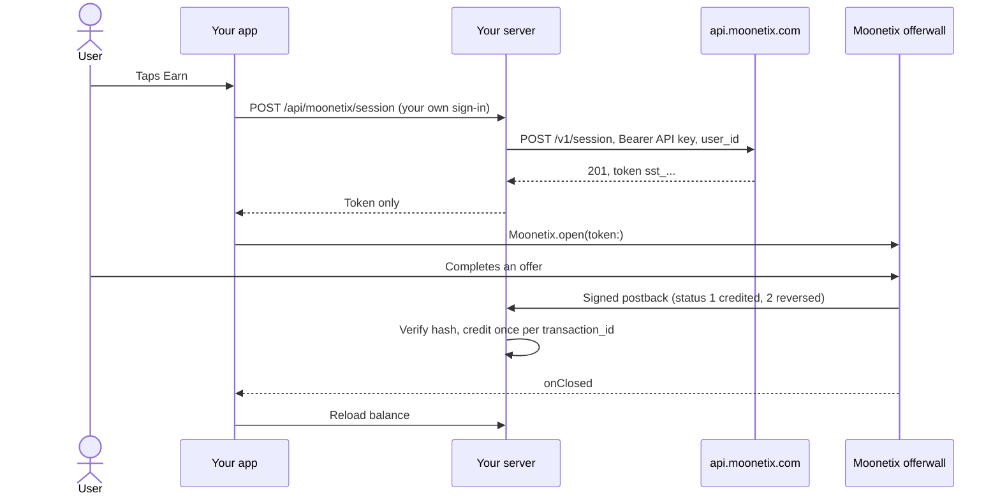

# Moonetix Offerwall SDK for iOS

**Install guide, SwiftUI sample and a tested token endpoint for the Moonetix iOS SDK.**

[](https://github.com/moonetix/moonetix-ios-sdk/actions/workflows/ci.yml)
[](https://moonetix.com)
[](LICENSE)
[](https://docs.moonetix.com/ios-sdk#spm)
[](https://docs.moonetix.com/ios-sdk#cocoapods)
[](https://docs.moonetix.com/ios-sdk)
[](https://moonetix.com/register?from=github-moonetix-ios-sdk)
[](https://moonetix.com/integrations/ios)

The [Moonetix](https://moonetix.com) iOS SDK shows the offerwall in a native screen with one call. It ships as a binary `MoonetixOfferwall.xcframework` (UIKit and WebKit only, no third-party dependencies), so this repository holds what you need around it: install steps, a minimal SwiftUI sample and the server endpoint that creates the session token. Moonetix is an affiliate network: your users earn your own currency by completing offers, and you earn per completed offer.

Everything here matches SDK version 2.0.1. The binary is not in Git: Swift Package Manager and CocoaPods download it from moonetix.com and check its SHA-256.

> **Get your App ID and API key: sign up free at https://moonetix.com/register?from=github-moonetix-ios-sdk**

## What this repository adds

- **A token endpoint you can run today.** `token-endpoint/` is a Node.js 22 server with no dependencies and 7 tests: sign-in required, user ID taken from the sign-in only, only the token returned. The Android, Flutter, React Native and Unity SDKs use the same endpoint.
- **No key in the app.** The app only ever holds a session token that works once and expires after 10 minutes. The API key and link hash salt stay on your server.
- **SwiftUI, UIKit and Objective-C.** The sample is three small Swift files, written from the official docs.

## Session and reward flow



## Quick start

### 1. Install

iOS 13 or newer, iPhone and iPad, built with Xcode 16 or newer. It works from Swift, SwiftUI and Objective-C.

**Swift Package Manager.** In Xcode, choose File, Add Package Dependencies, enter `https://moonetix.com/ios/moonetix-ios.git` and add the `MoonetixOfferwall` library to your app target. In a `Package.swift`:

```swift
dependencies: [
    .package(url: "https://moonetix.com/ios/moonetix-ios.git", from: "2.0.1"),
],
targets: [
    .target(name: "MyApp", dependencies: [
        .product(name: "MoonetixOfferwall", package: "moonetix-ios"),
    ]),
]
```

**CocoaPods.**

```ruby
pod 'MoonetixOfferwall', :podspec => 'https://moonetix.com/ios/2.0.1/MoonetixOfferwall.podspec'
```

**Manual.** Download [MoonetixOfferwall-2.0.1.xcframework.zip](https://moonetix.com/ios/MoonetixOfferwall-2.0.1.xcframework.zip), unzip it, drag `MoonetixOfferwall.xcframework` into your project and set it to Embed & Sign. Its SHA-256 is `03cd07f6d72c2e30722bcc950286207c3dfd494c39a9a6546389f87cb8da42fd`.

### 2. Run the token endpoint

Your app never calls `POST https://api.moonetix.com/v1/session` itself, because that needs the API key. The endpoint in `token-endpoint/` checks who is signed in, asks Moonetix for a session for that user, and returns only the token.

```bash
git clone https://github.com/moonetix/moonetix-ios-sdk.git
cd moonetix-ios-sdk/token-endpoint
cp ../.env.example .env    # set MOONETIX_API_KEY from the API page of your dashboard
npm test                   # 7 tests, no network needed
npm start                  # POST http://localhost:3000/api/moonetix/session
```

Then replace `demoAuthenticate()` in `server.mjs` with your own sign-in check. The demo accepts `Authorization: Bearer <token>` for the pairs in `DEMO_SESSIONS`, so you can try it with curl:

```bash
DEMO_SESSIONS=dev-session-1=user_1234 npm start
curl -X POST -H "Authorization: Bearer dev-session-1" http://localhost:3000/api/moonetix/session
```

`token-endpoint/token-endpoint.php` is the same endpoint in PHP, from the [docs](https://docs.moonetix.com/android-sdk#token-endpoint). Put the server behind HTTPS before an app talks to it.

| Variable | Default | Purpose |
| --- | --- | --- |
| `MOONETIX_API_KEY` | none, required | API key from the API page of your dashboard. The server refuses to start without it. |
| `PORT` | `3000` | Listen port |
| `DEMO_SESSIONS` | empty | Demo sign-in only: `token=userId` pairs, comma separated. Unused once you replace `demoAuthenticate()`. |
| `MOONETIX_API_BASE` | `https://api.moonetix.com` | Override for tests against a local stand-in |

| Your endpoint answers | When |
| --- | --- |
| 200 `{"token": "sst_..."}` | Moonetix created the session. |
| 401 `sign_in_required` | Nobody is signed in. Moonetix is not called. |
| 403 `offerwall_unavailable` | Moonetix answered `app_not_live` or `user_blocked`. Hide the Earn button. |
| 503 `offerwall_unavailable` | Any other problem, such as a wrong API key, rate limiting or a timeout after 10 seconds. The log line `Moonetix session failed <status> <error>` has the reason; the app never sees it. |
| 500 `offerwall_unavailable` | Your sign-in returned a user ID with characters Moonetix does not accept (allowed: letters, digits and `._@:+-`, up to 100). |
| 404, 405 | Wrong path, or a method other than `POST`. |

### 3. Open the offerwall

Call `configure` once, for example in `application(_:didFinishLaunchingWithOptions:)` or in your `App` initializer, with the App ID from the Integration section. Then open the offerwall with a fresh token from your server.

```swift
import MoonetixOfferwall

Moonetix.configure(appId: "YOUR_APP_ID")

// When the user taps Earn, with a token from your server:
Moonetix.open(token: token)

// Or present from a view controller of your choice:
Moonetix.open(token: token, from: self)
```

Objective-C:

```objc
@import MoonetixOfferwall;

[Moonetix configureWithAppId:@"YOUR_APP_ID"];
[Moonetix openWithToken:token from:self options:nil];
```

`open` never throws for offerwall problems. They arrive as events. To close the offerwall from your own code, for example when the user signs out, call `Moonetix.close()`.

### SwiftUI sample

`Sample/MoonetixSample/` holds a minimal SwiftUI app, written from the patterns in the docs:

| File | Purpose |
| --- | --- |
| `MoonetixSampleApp.swift` | Calls `Moonetix.configure(appId:)` once at launch |
| `TokenClient.swift` | Asks your token endpoint for a token (async/await, iOS 15) |
| `ContentView.swift` | Earn button, `onClosed` and `onError` events |

To run it:

1. In Xcode, create a new iOS App project with the SwiftUI interface and an iOS 15 deployment target.
2. Add the package `https://moonetix.com/ios/moonetix-ios.git` as shown above.
3. Replace the generated Swift files with the three files from `Sample/MoonetixSample/`.
4. Set `YOUR_APP_ID`, the token endpoint URL in `TokenClient.swift`, and your own sign-in token in `ContentView.swift`.
5. Run it on an iPhone or the Simulator, on a normal home or mobile connection.

On iOS 13 and 14, use `URLSession.dataTask` with a completion handler instead of async/await.

## Events

```swift
Moonetix.onClosed = { [weak self] in
    self?.refreshBalance()
}
Moonetix.onError = { error in
    print(error.code.name, error.message)
}
```

Prefer a delegate? Set `Moonetix.delegate` (a weak reference) to an object that adopts `MoonetixDelegate`: `moonetixDidOpen()`, `moonetixDidClose()` and `moonetixDidFail(with:)`. All events arrive on the main thread.

| Event | When |
| --- | --- |
| `onOpened` | The offerwall finished loading. |
| `onClosed` | The user closed the offerwall. Reload the user's balance from your server here. |
| `onError` | `NOT_INITIALIZED`, `INVALID_APP_ID`, `INVALID_TOKEN`, `TOKEN_EXPIRED_OR_USED`, `NETWORK` or `UNKNOWN`. Create a new session and try again. |

Events are for your user interface only. Credit rewards from the signed postback on your server, never from an event.

**Branding.** The top bar shows the Moonetix mark with your title and colors from the Design section. The mark loads only from `moonetix.com` and `wall.moonetix.com`. To set them yourself, pass `MoonetixOptions(title:toolbarColor:showLogo:)`. Pass `presentation: .sheet` to open the offerwall as a sheet.

## Step by step

1. Your app calls `Moonetix.configure(appId:)` once. The SDK checks the App ID format.
2. When the user taps Earn, the app asks your token endpoint for a token, sending your own sign-in credential.
3. The endpoint takes the user ID from that sign-in and calls `POST /v1/session` with the API key. It returns only the token.
4. `Moonetix.open(token:)` presents the offerwall. Only pages on `wall.moonetix.com` load inside it. App Store links open the App Store, other sites open in Safari.
5. If iOS pauses the offerwall in the background, it comes back where the user was, without using the token again.
6. Moonetix calls your postback URL when an offer is completed or reversed, and your server credits the user.

## Security notes

- Create sessions on your server only. Never put the API key or the link hash salt in your app: anyone can read an app's files.
- Take the user ID from your own sign-in, never from the request. The tests check that a `user_id` in the request body is ignored.
- Return only the token. Never pass the API key or the full Moonetix response on to the app. Responses carry `Cache-Control: no-store`.
- Do not keep tokens for later. Create a new one each time the user taps Earn.
- Credit rewards only from the signed server-to-server postback: verify the hash with a constant-time comparison first, credit each `transaction_id` once, and let status 2 take back only what was credited. See [offerwall-postback-handlers](https://github.com/moonetix/offerwall-postback-handlers).
- The web view is locked down: only offerwall pages load inside it, there is no JavaScript bridge into your app, and camera and microphone requests are denied. The SDK does no device fingerprinting and does not use the advertising identifier.
- Reward users only for completed offers. Never reward joins, invites, likes, reviews or other engagement. Users must be 16 or older.

**App Store privacy.** In App Store Connect, under App Privacy, add User ID, Device ID, Coarse Location and Product Interaction, each linked to the user, not used for tracking, for App Functionality. Details in the [docs](https://docs.moonetix.com/ios-sdk#privacy).

## Testing

### Token endpoint

```bash
cd token-endpoint
npm test
```

The tests start the endpoint against a local stand-in for `api.moonetix.com` and check: only the token is returned, with the API key as Bearer and the user ID from the sign-in; 401 without a valid sign-in and no call to Moonetix; 403 passed on; other errors and an unreachable API become 503; only `POST` is accepted; the server refuses to start without an API key.

The Swift sample was not compiled for this repository, because building for iOS needs Xcode on macOS.

### In the app

1. Create a session from your server for a test user ID and open it in a debug build on an iPhone or in the Simulator.
2. Check that the offerwall opens, that an offer opens in the App Store or Safari, and that the close button works.
3. In the dashboard, open Offerwalls, your offerwall, Integration, and click **Send a test postback**. You can also send one from the Postback page. Send status 1, then status 2 for the same user, and check that the balance goes up and back down.
4. Test on a normal home or mobile connection. On a VPN or a cloud test device the offerwall shows a block page such as VPN detected instead of offers.

### Troubleshooting

| What you see | Cause and fix |
| --- | --- |
| `INVALID_APP_ID` | The value in `configure(appId:)` is not the 24-character lowercase hex App ID. Passing the API key here is the usual mistake. |
| `INVALID_TOKEN` right after `open` | You passed the whole JSON answer or an empty string. Pass only the `token` field, which starts with `sst_`. |
| `INVALID_TOKEN` after the screen opened | The token was created with the API key of another app than the App ID in `configure`. |
| `TOKEN_EXPIRED_OR_USED`, or a Session ended page | The token is older than 10 minutes or was opened twice. Request a new token on every tap. |
| `UNKNOWN` | The offerwall is already open, or no view controller was on screen. Open it once at a time, or pass a visible one with `open(token:from:)`. |
| Endpoint log: `Moonetix session failed 401 invalid_api_key` | `MOONETIX_API_KEY` is wrong. Copy it again from the API page. |
| Delegate methods never fire | `Moonetix.delegate` is weak and the object was released. Keep a strong reference, or use the closures. |

More in the docs: [Troubleshooting](https://docs.moonetix.com/ios-sdk#troubleshooting) and [Testing](https://docs.moonetix.com/testing).

## References

- Docs: [iOS SDK](https://docs.moonetix.com/ios-sdk), [Postbacks](https://docs.moonetix.com/postbacks), [Credits and reversals](https://docs.moonetix.com/credits-and-reversals), [Testing](https://docs.moonetix.com/testing)
- Academy: [How to Add an Offerwall to an iOS App (Swift)](https://moonetix.com/academy/integrations/ios-offerwall-swift)
- Academy: [Can You Put an Offerwall in an iOS App? Apple's Rules](https://moonetix.com/academy/monetization/offerwall-ios-app-rules)
- Moonetix for iOS: [moonetix.com/integrations/ios](https://moonetix.com/integrations/ios)
- Moonetix for apps: [moonetix.com/industries/apps](https://moonetix.com/industries/apps)

## Publisher account

You need an approved account for the App ID and API key: **https://moonetix.com/register?from=github-moonetix-ios-sdk**. Every application is reviewed by a person. Then add the app, set its currency name and rate, and set `MOONETIX_API_KEY` for the token endpoint.

## More Moonetix examples

All on [github.com/moonetix](https://github.com/moonetix).

**Server side**

- [offerwall-postback-handlers](https://github.com/moonetix/offerwall-postback-handlers): postback handlers for common languages
- [offerwall-express](https://github.com/moonetix/offerwall-express), [offerwall-laravel](https://github.com/moonetix/offerwall-laravel), [offerwall-django](https://github.com/moonetix/offerwall-django)
- [offerwall-firebase-functions](https://github.com/moonetix/offerwall-firebase-functions), [offerwall-supabase](https://github.com/moonetix/offerwall-supabase)

**Web and apps**

- [offerwall-nextjs-starter](https://github.com/moonetix/offerwall-nextjs-starter), [offerwall-react-vite](https://github.com/moonetix/offerwall-react-vite), [offerwall-vue-nuxt](https://github.com/moonetix/offerwall-vue-nuxt)
- [rewards-site-starter](https://github.com/moonetix/rewards-site-starter), [moonetix-offerwall-wordpress](https://github.com/moonetix/moonetix-offerwall-wordpress)
- [offerwall-flutter-example](https://github.com/moonetix/offerwall-flutter-example), [offerwall-react-native-example](https://github.com/moonetix/offerwall-react-native-example)
- [offerwall-chrome-extension](https://github.com/moonetix/offerwall-chrome-extension), [offerwall-electron](https://github.com/moonetix/offerwall-electron)

**Games and communities**

- [offerwall-unity-example](https://github.com/moonetix/offerwall-unity-example), [offerwall-godot](https://github.com/moonetix/offerwall-godot), [offerwall-html5-game](https://github.com/moonetix/offerwall-html5-game)
- [telegram-mini-app-offerwall](https://github.com/moonetix/telegram-mini-app-offerwall), [discord-rewards-bot](https://github.com/moonetix/discord-rewards-bot)
- [awesome-offerwalls](https://github.com/moonetix/awesome-offerwalls): a curated list of offerwall resources

## License

Apache License 2.0. See [LICENSE](LICENSE).
